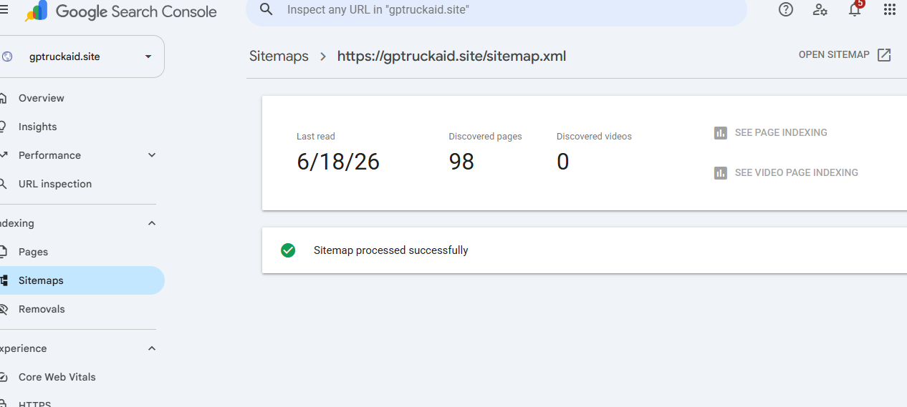

# GP Truck Aid | Digital Business, Website Development & Interactive Tools

A practical digital portfolio project combining business concept development, website planning, branding, digital presence, search visibility, AI-assisted research and interactive web-based tools.

This repository documents the development of GP Truck Aid, an original heavy-vehicle emergency assistance business concept, together with its historical website and digital presence. It also showcases a separate, working Fuel & Trip Profitability Calculator developed as an interactive portfolio demonstration.

The project brings together business understanding, creative development, online research and practical digital problem-solving.

---

# 1. The Original GP Truck Aid Business Concept

## 24-Hour Heavy-Vehicle Emergency Assistance & Dispatch

GP Truck Aid was originally developed as a concept for a **24-hour heavy-vehicle emergency assistance dispatch and coordination service across Gauteng, South Africa**.

The main purpose was to help truck and bus drivers, fleet operators and businesses find assistance when a commercial vehicle experienced a breakdown or required urgent support.

The concept centred on connecting people who needed assistance with appropriate service providers.

The intended services included:

- 24-hour heavy-vehicle breakdown assistance.
- Emergency truck towing.
- Heavy-vehicle recovery.
- Mechanical repair assistance.
- Coordination and dispatch of relevant service providers.
- Helping drivers and operators find assistance when a vehicle could not continue its journey.
- Providing access to relevant support for commercial vehicles operating across Gauteng.

The central idea was to make it easier for drivers and operators to find the right assistance when a heavy vehicle broke down, helping them deal with vehicle downtime and the practical challenges of getting back on the road.

## The Website Was More Than an Emergency Service Advertisement

Although emergency assistance and dispatch were the main purpose of GP Truck Aid, the website was also intended to provide useful information, resources and practical tools for people working in the commercial vehicle and fleet environment.

The wider website content included:

- Health and Safety information relevant to fleet operations.
- Resources for depots, warehouses and workshops.
- General fleet and commercial vehicle information.
- Information about common mechanical faults.
- Educational articles about vehicle problems and maintenance-related topics.
- Blog articles and general industry information.
- Practical calculators and useful tools.
- Additional information intended to help drivers, operators and businesses.

The aim was to develop a useful online resource around the heavy-vehicle industry, while keeping emergency assistance and service coordination at the centre of the business concept.

## Original Website Status

The original GP Truck Aid website is no longer live, and its original live version cannot be retrieved.

The screenshots and supporting material included in this repository are historical evidence of the original website, branding, online presence and search visibility work.

This repository preserves that project history and separately showcases new interactive portfolio development.

---

# 1. Interactive Portfolio Demonstration

## Fuel & Trip Profitability Calculator

**[OPEN THE LIVE FUEL & TRIP PROFITABILITY CALCULATOR](https://cindy3885.github.io/GP-truck-aid-digital-operations-tools/fleet-management/)**

A working interactive calculator developed as a separate portfolio demonstration, inspired by the commercial vehicle and fleet industry.

This is one of the practical tools developed to demonstrate how a business-related requirement can be translated into a functional web-based solution.

### What the calculator does

Users can enter trip and vehicle information to estimate:

- Trip distance.
- Vehicle fuel consumption.
- Fuel required for the trip.
- Fuel price per litre.
- Estimated fuel cost.
- Additional trip expenses.
- Total trip expenses.
- Expected trip revenue.
- Estimated profit or loss.
- Cost per kilometre.

The calculator displays financial results in South African Rand (ZAR).

### Development and functionality

- Interactive input fields.
- JavaScript calculation logic.
- Input validation.
- Error handling.
- Automatic calculations.
- Currency formatting.
- Responsive page styling.
- Separate HTML, CSS and JavaScript files.
- Published through GitHub Pages.

### Example calculation

| Input or Result | Example |
|---|---:|
| Trip distance | 450 km |
| Fuel consumption | 32 L / 100 km |
| Fuel price | R23.50 / litre |
| Additional expenses | R1,200 |
| Expected revenue | R8,500 |
| Estimated fuel required | 144 litres |
| Estimated fuel cost | R3,384 |
| Total expenses | R4,584 |
| Estimated profit | R3,916 |
| Cost per kilometre | R10.19 |

*Example figures are for demonstration purposes.*

**[TRY THE WORKING CALCULATOR](https://cindy3885.github.io/GP-truck-aid-digital-operations-tools/fleet-management/)**

**Important:** This calculator is a separate portfolio development project. It is not presented as a working feature of the original GP Truck Aid website or as a currently operating business service.

---

# 3. Original Branding & Logo Development

The original project included the development of a visual identity for GP Truck Aid.

The following images document the different logo concepts and the final logo.

## Logo Concept 1

## Logo Concept 2

## Logo Concept 3

## Final Logo

The branding work formed part of developing a recognisable business identity and a consistent visual presentation for the original website and digital presence.

---

# 4. Original Website Homepage & Promotional Content

The original homepage included promotional messaging explaining the emergency assistance service and the geographical area it was intended to serve.

The following cropped image was taken from the original website homepage. It shows part of the promotional content, rather than the complete website layout or navigation.

**Original homepage message:**

“Best 24-hour emergency truck repairs and heavy vehicle towing across Gauteng.”

This image is retained as historical website content and illustrates the original service positioning.

---

# 5. Original Website & Digital Presence

The original website and digital presence involved more than simply publishing business information online.

The work included planning the website, presenting the services and resources, establishing the business's online presence and investigating how potential visitors could find it.

## Website Planning & Content

Areas of work included:

- Planning the website structure and pages.
- Organising business and service information.
- Presenting the emergency assistance concept.
- Developing website descriptions and content.
- Planning information and resource sections.
- Considering the needs of drivers, fleet operators and businesses.
- Creating content relevant to the heavy-vehicle industry.
- Improving the organisation and presentation of information.

## Website and Domain Setup

The project also involved working with the website's online setup and search engine configuration.

This included:

- Domain setup and configuration.
- DNS verification.
- Google Search Console.
- XML sitemap creation.
- Search engine indexing.
- Monitoring website indexing information.
- Investigating search visibility.

---

# 6. Historical Website & Search Visibility Evidence

The following screenshots document parts of the original GP Truck Aid website setup, Google search visibility and digital presence.

They are included directly in this README so that visitors can view the evidence without having to navigate through separate folders.

## Google Search Result

## Domain Setup

## Google Search Console – DNS Verification

## XML Sitemap

## Google Search Console – Page Indexing

---

# 7. Facebook Business Presence

The original GP Truck Aid project also included establishing a Facebook business presence.

The following eight screenshots preserve examples of the original Facebook content and business presence.

## Facebook Screenshot 1

## Facebook Screenshot 2

## Facebook Screenshot 3

## Facebook Screenshot 4

## Facebook Screenshot 5

---

# 8. SEO, Search Visibility & Generative AI Visibility

An important part of the project involved exploring how a small business website could become easier to discover online.

This included traditional search engine visibility as well as the emerging role of AI-powered search and conversational assistants.

## Search Engine Optimisation (SEO)

Practical areas explored included:

- Search intent and keyword research.
- Website content relevance.
- Search engine indexing.
- Google Search Console.
- XML sitemap creation and submission.
- Domain ownership and DNS verification.
- Website structure and navigation.
- Internal linking.
- Online directory research.
- Backlink research and opportunities.
- Improving website discoverability.

## Generative Engine Optimisation (GEO) & AI Search Visibility

The project also explored how AI assistants might discover, identify and describe GP Truck Aid when asked questions about the business.

This involved testing ChatGPT while logged out and documenting the responses received.

The purpose was to explore the relationship between a business's online information and the way generative AI systems interpret and present that information.

### ChatGPT Query 1

### ChatGPT Query 2

These screenshots are historical evidence of the responses received at the time of testing. They do not guarantee current search rankings or permanent AI visibility.

---

# 9. Skills Demonstrated

This project combines business, operational, creative and digital skills.

It demonstrates the ability to understand a business requirement, research possible solutions, work with unfamiliar tools and develop practical digital outputs.

## Business & Operational Skills

- Business concept development.
- Understanding business needs and objectives.
- Identifying customer and industry requirements.
- Researching practical business solutions.
- Service planning and coordination concepts.
- Organising business information.
- Understanding operational challenges in the commercial vehicle environment.
- Translating business ideas into digital resources.
- Practical problem-solving.
- Independent research and learning.

## Website & Digital Development

- Website planning and structure.
- Website page development.
- HTML.
- CSS.
- JavaScript.
- Working with separate website files.
- Basic front-end development.
- Interactive web functionality.
- Building and testing calculator logic.
- Input validation and error handling.
- Responsive layout considerations.
- Website publishing using GitHub Pages.

## Design & Creative Skills

- Canva.
- Brand and visual identity development.
- Logo and graphic design.
- Visual communication.
- Website content presentation.
- Creative concept development.
- Digital content planning.
- AI-assisted creative research and development.

## Digital Presence & Online Discoverability

- Google Search Console.
- Domain setup and configuration.
- DNS verification.
- XML sitemap creation.
- Search engine indexing.
- Search visibility research.
- Keyword and search intent research.
- Website content organisation.
- Internal linking.
- Facebook business presence.
- Online directory research.
- Backlink research and opportunities.
- SEO fundamentals.
- Generative Engine Optimisation (GEO) exploration.
- AI search visibility testing.

## Interactive Tools & Practical Development

- Identifying a practical business problem.
- Planning a useful digital tool.
- Translating requirements into calculator inputs and outputs.
- HTML form and input development.
- JavaScript calculations.
- Fuel and trip cost calculations.
- Profit and loss estimates.
- Cost-per-kilometre calculations.
- Data validation.
- Error handling.
- Testing and debugging.
- Improving usability and presentation.

## AI-Assisted Research & Development

- ChatGPT.
- Microsoft Copilot.
- AI-assisted research.
- Exploring unfamiliar technologies.
- Developing and refining ideas.
- Assistance with code development.
- Reviewing and testing functionality.
- Troubleshooting and debugging.
- Improving written content.
- Using AI as a practical learning and development resource.

## Project & Digital Workflow Skills

- GitHub repository management.
- GitHub Pages publishing.
- File and folder organisation.
- Markdown documentation.
- Version control through commits.
- Maintaining project documentation.
- Organising digital evidence.
- Testing and refining work.
- Independent learning.
- Researching and adapting to new platforms.
- Taking a project from an initial idea through to a practical demonstration.

---

# 10. Tools & Technologies

| Area | Tools and Technologies |
|---|---|
| Website development | HTML, CSS, JavaScript |
| Repository and publishing | GitHub, GitHub Pages |
| Documentation | Markdown |
| Creative design | Canva |
| Search visibility | Google Search Console |
| Website discoverability | XML sitemaps, domain and DNS configuration |
| Social presence | Facebook |
| AI-assisted research | ChatGPT, Microsoft Copilot |
| Interactive development | JavaScript, browser-based testing |

---

# 11. Project Approach

The project demonstrates a practical approach to developing digital solutions:

1. Understand the original business concept and the people it is intended to serve.
2. Identify the main service requirements and wider information needs.
3. Plan the website, content and online presence.
4. Develop the brand and visual presentation.
5. Work with digital platforms and tools to establish an online presence.
6. Investigate search engine and AI discoverability.
7. Develop practical interactive resources.
8. Test, troubleshoot and refine the results.
9. Document the work and make it accessible through GitHub.

It also demonstrates the value of learning by doing, researching unfamiliar systems and using available technology to turn ideas into practical outcomes.

---

# 12. Project Status & Portfolio Scope

The original GP Truck Aid business concept was developed around 24-hour heavy-vehicle emergency assistance dispatch and coordination across Gauteng, supported by website information, resources and practical tools.

The original website is no longer live, and its original live version cannot be retrieved. The historical screenshots, branding and digital presence evidence are preserved in this repository.

The Fuel & Trip Profitability Calculator is a separate, functional portfolio demonstration developed to showcase practical website development and interactive tool-building skills.

This repository serves as a developing portfolio of business-focused digital projects, website development, creative work, online visibility research, interactive tools and AI-assisted problem-solving.

---

**Project:** GP Truck Aid – Digital Business & Interactive Tools

**Repository:** [GP Truck Aid Digital Operations Tools](https://github.com/cindy3885/GP-truck-aid-digital-operations-tools)

**Live interactive demonstration:** [Fuel & Trip Profitability Calculator](https://cindy3885.github.io/GP-truck-aid-digital-operations-tools/fleet-management/)

