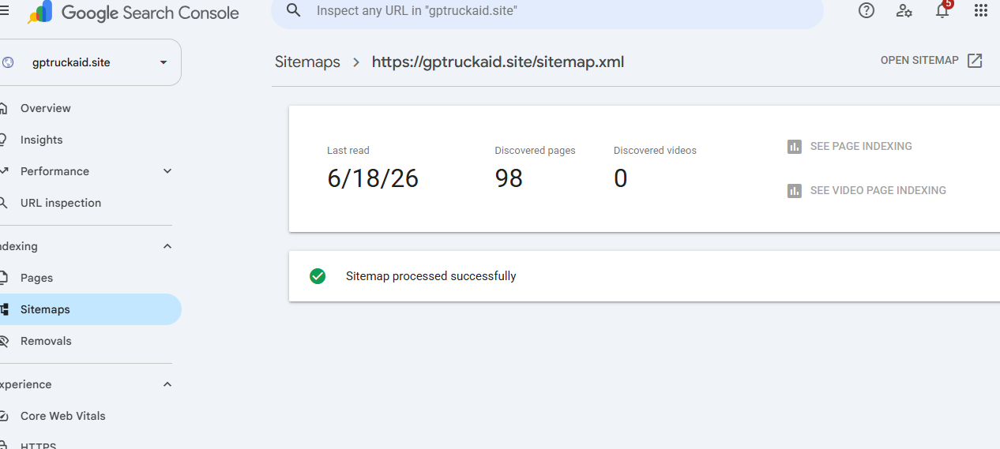

# GP Truck Aid – Original Digital Presence

This section documents the digital presence developed for the original GP Truck Aid business project.

The work included website development, domain configuration, Google Search Console setup, sitemap submission, search indexing research and Facebook business page development.

The original website is no longer hosted and is not available as a live website. The screenshots below preserve examples of the digital work and online presence established during the project.

---

## 1. Original Website & Google Search Presence

The original website provided the online presence for the GP Truck Aid business concept.

The following screenshot records an example of the business appearing in Google search results.

### Google Search Result

---

## 2. Domain Setup & Verification

Setting up the online presence involved domain configuration and DNS verification to connect the website with Google's services.

### Domain Setup

### Google Search Console DNS Verification

---

## 3. Sitemap & Website Indexing

Google Search Console was used to submit the website sitemap and monitor Google's discovery and indexing of website pages.

These screenshots provide historical evidence of the sitemap and indexing information available during the project.

### XML Sitemap

### Page Indexing Report

### Additional Page Indexing Information

---

## 4. Facebook Business Presence

A Facebook business presence was also developed to support the brand's online visibility and provide another channel for communicating the business concept and services.

The following screenshots document examples of the original Facebook page and its content.

### Facebook Page & Content

---

## 5. Project Notes

The screenshots in this section are historical evidence from the original GP Truck Aid digital business project.

They demonstrate practical work involving:

- Website and online presence development
- Domain and DNS configuration
- Google Search Console setup
- XML sitemap submission
- Search indexing monitoring
- Facebook business page development
- Digital content and online business presentation

The original website is no longer hosted. These materials are retained for portfolio and project documentation purposes.

For examples of AI search visibility, GEO exploration and ChatGPT business discovery, see the separate [SEO & Search Visibility](../seo-and-search-visibility/README.md) section.

---

**GP Truck Aid – Original Digital Presence & Website Evidence**

